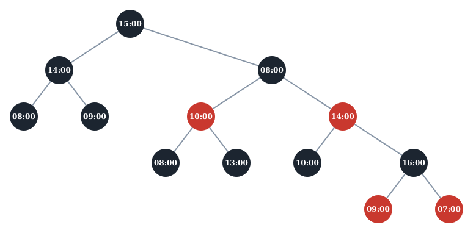

# Sistema de Reserva de Salas — Árvore Rubro-Negra

## Informações da Disciplina

**Disciplina:** Estruturas de Dados 2 — 2026.2  
**Professor:** Maurício Serrano  
**Trabalho:** Trabalho 3 — Árvores  
**Tema:** Árvore Rubro-Negra (Red-Black Tree)

## Alunos

| Matrícula | Nome |
|---|---|
| 23/1026699 | Eduarda Domingos Rodrigues |
| 23/1012316 | Yasmin Moreira do Nascimento |

## Descrição do Projeto

Este projeto foi desenvolvido para a disciplina de **Estruturas de Dados 2**, com o objetivo de aplicar e analisar o funcionamento de árvores balanceadas na resolução de problemas computacionais.

A proposta consiste em um **Sistema de Reserva de Salas e Laboratórios**, no qual os usuários podem consultar a disponibilidade de espaços, realizar reservas e identificar conflitos de horários.

A estrutura de dados utilizada é a **Árvore Rubro-Negra (Red-Black Tree)**, implementada manualmente em Python. Essa estrutura mantém os dados organizados e balanceados, permitindo realizar operações de busca, inserção e remoção com complexidade de tempo O(log n) no pior caso.

Cada sala possui sua própria árvore, responsável por armazenar as reservas ordenadas pelo horário de início.

A aplicação permite:

- Visualizar a disponibilidade das salas e laboratórios.
- Realizar reservas e cancelar agendamentos.
- Identificar conflitos entre horários.
- Consultar salas disponíveis conforme a capacidade e o tipo.
- Visualizar os horários livres de uma sala.
- Acompanhar a estrutura da Árvore Rubro-Negra.
- Consultar estatísticas de altura, rotações e comparações.
- Comparar o desempenho da árvore com uma busca sequencial em lista.

O sistema utiliza um servidor desenvolvido em **Python com Flask**, uma interface em **HTML, CSS e JavaScript** e armazenamento local em arquivos JSON.

## Problema Abordado

### Gerenciamento de Reservas e Conflitos de Horários

O problema consiste em organizar reservas de salas e laboratórios, garantindo que dois agendamentos não ocupem o mesmo espaço em horários conflitantes.

Em uma abordagem convencional, seria possível percorrer uma lista de reservas para verificar a disponibilidade de determinado horário.

Entretanto, conforme a quantidade de reservas aumenta, a busca sequencial pode exigir a análise de muitos registros, apresentando complexidade O(n).

Para melhorar a eficiência das consultas, o projeto utiliza uma **Árvore Rubro-Negra**, que mantém os horários organizados e a altura da estrutura limitada a O(log n).

### Como a Árvore Resolve os Conflitos

As reservas são armazenadas em ordem cronológica de início.

Para verificar se um novo intervalo pode ser reservado, o algoritmo consulta os horários vizinhos na árvore:

- **Reserva anterior:** identifica o agendamento com maior horário de início menor ou igual ao solicitado.
- **Próxima reserva:** identifica o agendamento com menor horário de início maior que o solicitado.

A nova reserva será considerada conflitante quando houver sobreposição entre os intervalos.

Caso não exista conflito, o agendamento poderá ser inserido na árvore.

Essa estratégia permite verificar a disponibilidade sem percorrer todas as reservas cadastradas, utilizando consultas com complexidade O(log n).

### Árvore Rubro-Negra

A Árvore Rubro-Negra é uma árvore binária de busca autobalanceada, na qual os nós possuem uma propriedade adicional de cor: vermelho ou preto.

Sua organização segue regras que limitam a altura da árvore, evitando a formação de estruturas excessivamente desbalanceadas.

Entre suas principais propriedades estão:

- Cada nó possui uma cor vermelha ou preta.
- A raiz da árvore é preta.
- Os nós externos nulos são considerados pretos.
- Um nó vermelho não pode possuir filhos vermelhos.
- Todos os caminhos de um nó até seus descendentes nulos possuem a mesma quantidade de nós pretos.

Durante as operações de inserção e remoção, podem ser realizados ajustes de cores e rotações para preservar essas propriedades.

A estrutura permite executar:

| Operação | Complexidade no pior caso |
|---|---|
| Busca | O(log n) |
| Inserção | O(log n) |
| Remoção | O(log n) |
| Consulta de predecessor | O(log n) |
| Consulta de sucessor | O(log n) |

## Funcionalidades do Sistema

### Gerenciamento de Reservas

A interface permite cadastrar e cancelar reservas, visualizar a ocupação das salas e consultar a disponibilidade de horários.

O sistema considera as seguintes regras:

- As reservas devem começar e terminar no mesmo dia.
- O horário permitido é das 07h às 22h.
- O título e o responsável são obrigatórios.
- Reservas com horários sobrepostos não são permitidas.
- Reservas consecutivas são permitidas quando o término de uma coincide com o início de outra.

### Visualização da Disponibilidade

A aplicação apresenta um mapa diário das salas, com horários organizados horizontalmente.

Os períodos disponíveis e ocupados são diferenciados visualmente, facilitando a identificação de horários livres.

O usuário também pode selecionar um intervalo disponível para preencher os dados de uma nova reserva.

### Busca de Salas Disponíveis

O sistema permite procurar salas livres de acordo com:

- Data e horário desejados.
- Capacidade do ambiente.
- Tipo de espaço, como sala ou laboratório.

A busca considera as reservas existentes e apresenta os ambientes compatíveis com os critérios informados.

### Visualização da Árvore

A aplicação disponibiliza uma representação gráfica da Árvore Rubro-Negra de cada sala.

Essa funcionalidade permite acompanhar:

- Organização dos nós.
- Cores dos nós.
- Altura da árvore.
- Altura negra.
- Quantidade de rotações.
- Validação das propriedades da estrutura.

Essa visualização facilita a compreensão do funcionamento da árvore e dos ajustes realizados durante a manutenção do balanceamento.

## Guia de Instalação

O projeto utiliza um servidor local desenvolvido em Python com Flask e uma interface construída em HTML, CSS e JavaScript.

### Dependências do Projeto

- Python 3.9 ou superior.
- Flask 3.0 ou superior.
- Navegador atualizado.
- Git, caso o projeto seja obtido por clonagem.

### Como Executar o Projeto

Clone o repositório:

```bash
git clone https://github.com/eduardar01/trabalh03-eda2.git
```

Entre na pasta:

```bash
cd trabalh03-eda2
```

Crie um ambiente virtual:

```bash
python -m venv venv
```

Ative o ambiente virtual.

No Windows:

```powershell
venv\Scripts\activate
```

No Linux ou macOS:

```bash
source venv/bin/activate
```

Instale as dependências:

```bash
pip install -r requirements.txt
```

Execute a aplicação:

```bash
python src/app.py
```

Após iniciar o servidor, abra no navegador:

```text
http://127.0.0.1:5000
```

Mantenha o terminal aberto enquanto utiliza a aplicação.

Para encerrar o servidor, pressione **Ctrl+C**.

### Dados de Exemplo

Na primeira execução, o sistema cria o arquivo `data/reservas.json` com dados de demonstração contendo seis salas e reservas para os próximos 14 dias.

Para gerar novamente os dados de exemplo:

```bash
python scripts/popular_exemplo.py
```

### Testes Automatizados

O projeto possui testes para verificar o funcionamento da Árvore Rubro-Negra, das regras de agendamento e dos endpoints da aplicação.

Para executar os testes:

```bash
python -m unittest discover -s tests -v
```

### Experimento de Desempenho

Para executar a comparação entre a Árvore Rubro-Negra e a busca sequencial:

```bash
python scripts/benchmark.py --saida docs/resultados_benchmark.md
```

O experimento gera os resultados no arquivo indicado.

## Estrutura do Projeto

```text
trabalh03-eda2/
├── README.md
├── requirements.txt
├── src/
│   ├── app.py
│   ├── rubro_negra.py
│   ├── agenda.py
│   ├── armazenamento.py
│   ├── exemplo.py
│   └── visualizar.py
├── frontend/
│   ├── index.html
│   ├── css/
│   │   └── style.css
│   └── js/
│       └── script.js
├── data/
├── scripts/
│   ├── benchmark.py
│   └── popular_exemplo.py
├── tests/
│   ├── test_rubro_negra.py
│   ├── test_agenda.py
│   └── test_api.py
└── docs/
    ├── resultados_benchmark.md
    └── imagens/
        └── arvore_de_uma_sala.png
```

## Capturas de Tela

As imagens desta seção apresentam a estrutura da Árvore Rubro-Negra utilizada pelo sistema.

### Visualização da Árvore Rubro-Negra

A imagem apresenta uma árvore com reservas organizadas conforme o horário de início, permitindo observar a distribuição dos nós e suas respectivas cores.



## Análise de Desempenho

Para avaliar a eficiência da estrutura, foi implementado um experimento comparando a verificação de conflitos por meio da Árvore Rubro-Negra e de uma varredura sequencial em lista.

As duas abordagens foram submetidas a diferentes quantidades de reservas, permitindo observar o crescimento do número de operações e do tempo de consulta.

### Resultados do Experimento

A tabela apresenta os resultados registrados no arquivo `docs/resultados_benchmark.md`.

| Reservas | Altura da árvore | Nós visitados (média) | Comparações na lista (média) |
|---:|---:|---:|---:|
| 1.000 | 17 | 15,9 | 701,4 |
| 10.000 | 24 | 20,7 | 6.656,3 |
| 100.000 | 31 | 26,1 | 69.767,9 |

### Tempo de Execução

| Reservas | Árvore Rubro-Negra | Busca sequencial |
|---:|---:|---:|
| 1.000 | 1,5 µs | 23,5 µs |
| 10.000 | 2,4 µs | 250,7 µs |
| 100.000 | 4,0 µs | 2,58 ms |

Os resultados demonstram que a quantidade de operações necessárias para consultar a árvore cresce lentamente em relação ao número de reservas.

Na busca sequencial, o aumento do conjunto de dados provoca um crescimento mais significativo na quantidade de comparações.

As duas abordagens produziram os mesmos resultados de identificação de conflitos nos cenários avaliados.

Os tempos apresentados correspondem às medições registradas no experimento e podem variar de acordo com o ambiente de execução.

## Conclusões

O desenvolvimento do Sistema de Reserva de Salas e Laboratórios permitiu aplicar os conceitos de **Árvores Rubro-Negras** em um problema prático de gerenciamento de horários.

A implementação demonstrou como uma estrutura autobalanceada pode contribuir para a eficiência das operações de busca, inserção e remoção de reservas.

Nos experimentos realizados, a Árvore Rubro-Negra apresentou um crescimento significativamente menor no número de nós visitados quando comparada à varredura sequencial de uma lista.

Mesmo com o aumento de 1.000 para 100.000 reservas, a altura da árvore permaneceu controlada, evidenciando a importância do balanceamento para o desempenho das consultas.

Além disso, a implementação de recursos como a visualização dos nós, as estatísticas de rotações e a validação das propriedades da árvore contribuiu para compreender o funcionamento interno dessa estrutura de dados.

Entretanto, o sistema apresenta limitações por ter sido desenvolvido para fins acadêmicos. O armazenamento utiliza arquivos JSON e a aplicação é executada localmente, sem mecanismos de autenticação de usuários.

Em uma aplicação de maior escala, seria importante utilizar um banco de dados e implementar recursos adicionais de controle de acesso e gerenciamento de reservas.

Conclui-se que a Árvore Rubro-Negra é uma alternativa eficiente para organizar informações que exigem consultas e atualizações frequentes, especialmente quando a quantidade de registros é elevada.

## Referências

- CORMEN, T. H.; LEISERSON, C. E.; RIVEST, R. L.; STEIN, C. **Introduction to Algorithms**. 3. ed. MIT Press, 2009. Capítulos 13 e 14.

- PYTHON SOFTWARE FOUNDATION. **Python Documentation**. Disponível em: https://docs.python.org/3/

- PALLETS PROJECTS. **Flask Documentation**. Disponível em: https://flask.palletsprojects.com/

- SERRANO, Maurício. **Material didático da disciplina Estruturas de Dados 2**. Universidade de Brasília, 2026.

- EDA2-2026. **Sistema de Busca de Vagas — G4_Busca_EDA2-2026.2**. Referência de organização da documentação. Disponível em: https://github.com/eda2-2026/G4_Busca_EDA2-2026.2
